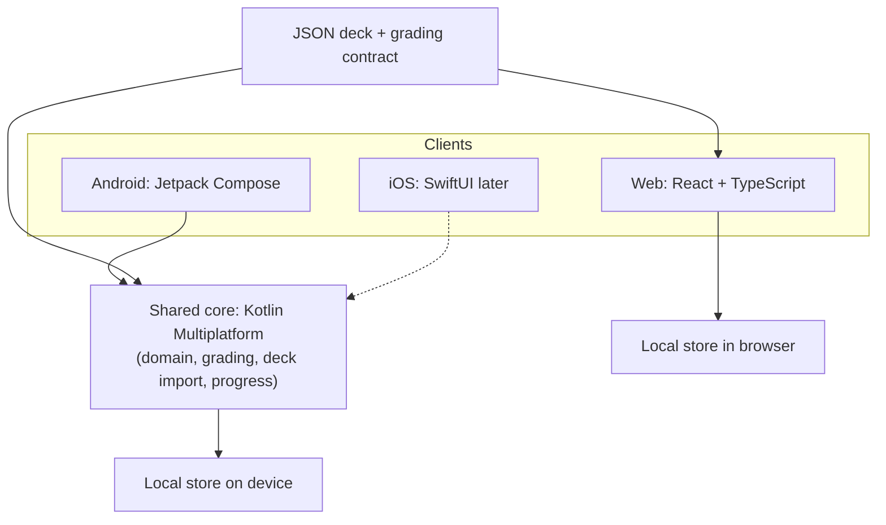

# Architecture — overview

## Idea in one sentence

Shared **domain core** (Kotlin Multiplatform) for Android (and later iOS) + **native UI** per platform + **local** deck/progress storage; web mirrors the deck and grading **contract** in TypeScript without a KMP binary.

## Diagram



## Layers

| Layer | Responsibility | Does not do |
|-------|----------------|-------------|
| UI (per platform) | Presentation, navigation, gestures, platform pickers | Grading rules, deck schema validation as source of truth |
| Core (KMP) | Domain model, import/validate, grading, session queue, progress | UI widgets, layout |
| Web thin domain | Same grading/import rules as documented contract (TS copy) | Parallel product features not in the contract |
| Local store | Persist decks and progress on that device/browser | Sync across devices (out of scope) |

## Target repository layout

Tooling decision: [ADR 0005](../decisions/0005-monorepo-tooling.md).

```
TestHive/                  # local folder may remain Testownik
  settings.gradle.kts      # Gradle: :core, :apps:android
  gradle/
  package.json             # root scripts (pnpm) — orchestration
  pnpm-workspace.yaml      # apps/web
  core/                    # KMP: domain, grading, import, progress
  apps/
    android/               # Jetpack Compose
    web/                   # React + TS + Vite
    ios/                   # later, when OQ-02 closes
  docs/                    # documentation and ADRs
```

### Top-level ownership

| Path | Responsibility | Build |
|------|----------------|-------|
| `core/` | Shared logic for mobile; **no** UI | Gradle (KMP) |
| `apps/android/` | Compose UI + Android wiring | Gradle |
| `apps/web/` | React/TS UI + TS grading/import | pnpm / Vite |
| `apps/ios/` | SwiftUI (later) | Xcode + KMP framework |
| `docs/` | Vision, architecture, ADRs, samples | — |

## Architectural principles

1. **One grading truth in docs** — [templates](../domain/templates.md) + fixtures; Android implements in KMP, web reimplements in TS ([ADR 0006](../decisions/0006-web-grading-in-typescript.md)).
2. **Thin UI** — clients render and delegate; no second set of product rules in Compose/React beyond presentation.
3. **Local first** — no account, no server ([ADR 0002](../decisions/0002-local-only-storage.md)).
4. **Strict import** — invalid deck file → reject entire import.
5. **Docs before deep code** — new foundational choices → ADR.

## Related documents

- [Tech stack](tech-stack.md)
- [Shared core](shared-core.md)
- [Clients](clients.md)
- [Data and sync](data-and-sync.md)
- [Auth](auth.md)
