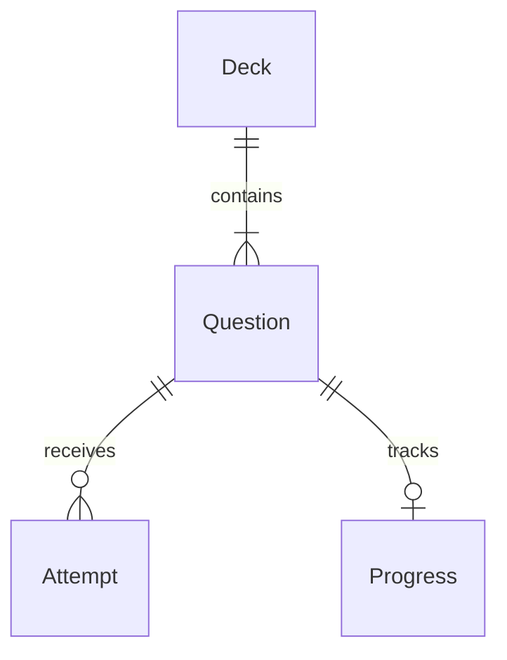

# Data model (outline)

Entity outline only — not a database schema. Local persistence technology is chosen at scaffold.

## Deck

| Field | Notes |
|-------|--------|
| `formatVersion` | Must be `1` for this contract |
| `id` | Stable deck id (string); used in progress keys |
| `title` | Display name |
| `language` | BCP 47 tag for content (e.g. `en`, `pl`) |
| `description` | Optional |
| `questions` | Non-empty list of questions |

## Question (common)

| Field | Notes |
|-------|--------|
| `id` | Stable within the deck |
| `type` | Template id |
| `prompt` | Stem text |
| `code` | Optional `{ language, source }` block (e.g. C++) |
| `explanation` | Short feedback after grade |
| type-specific fields | See [templates](templates.md) |

## Attempt (runtime)

| Field | Notes |
|-------|--------|
| `deckId` | |
| `questionId` | |
| `submitted` | Shape depends on template |
| `correct` | Boolean (for `reveal`, equals self-report “knew it”) |
| `answeredAt` | Timestamp |

## Progress

| Field | Notes |
|-------|--------|
| `deckId` + `questionId` | Composite key |
| `correctCount` | |
| `wrongCount` | |
| `lastResult` | correct / wrong |
| `lastAnsweredAt` | |

Unseen questions have no progress row (or equivalent empty state).

## Relationships

